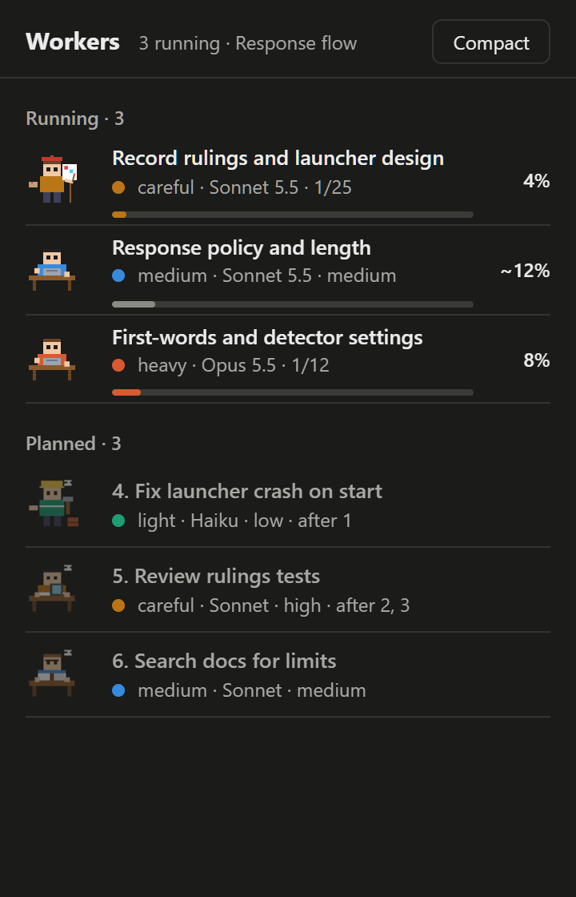
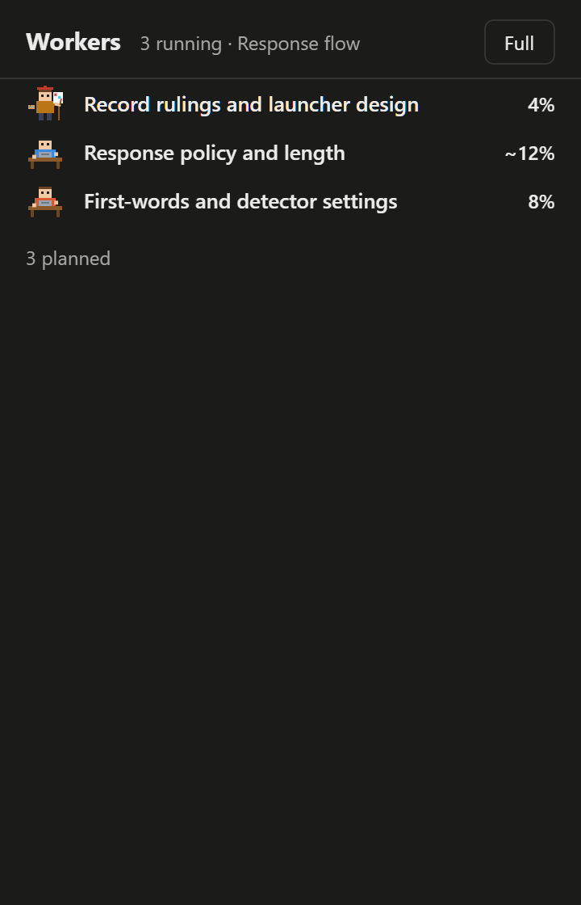

# agent-office

**See your AI agents work in their own window, even when Claude is minimized.**

A mod for [Claude Code](https://claude.com/claude-code). Its main purpose is the **separate Workers window**: a small floating window that shows what your helper agents (subagents) are doing right now. Minimize Claude, switch to your editor, browser or another screen, and the window stays where you put it.

<p align="center">
  
  &nbsp;&nbsp;
  
</p>
<p align="center"><sub>The Workers window, full and compact. Sample data.</sub></p>

## Why

Long agent jobs take minutes. Without this, you either stare at the Claude window or keep coming back to check. With it, you can:

- **Keep working** on something else and glance at the window to see who is busy, who is done and what is next.
- **Stop guessing.** Each worker shows its task, model, progress and time, so you know when to step in.
- **Run several projects at once.** Each project gets its own window, so they never overlap.

## What it adds

- **A separate Workers window** for each project. Move it anywhere on your screen, minimize it like any window. It keeps updating while the Claude app is minimized.
- **An agents panel** (`/agents-info`) inside Claude: running, finished and planned agents as little pixel office workers, with model, progress, context use, estimated cost and time.
- **A progress bar** above the message box: the task name, the phase, and how many steps are done.

Based on [johnnyvizz/claude-kit](https://github.com/JohnnyVizz/claude-kit) (MIT). This version adds the pixel workers, roles, the separate window and the per-project windows.

## Install

You need Claude Code (terminal or desktop app). The Workers window needs Windows with Microsoft Edge or Google Chrome installed.

### Terminal

```
/plugin install agent-office --marketplace Leromem/agent-office
```

1. Answer `y` to **Add marketplace?**
2. Press Enter to choose the **user** scope, so it works in every project.
3. Start a new chat.

From a normal shell instead:

```bash
claude plugin install agent-office --marketplace Leromem/agent-office
```

### Claude desktop app

`/plugin` does not run in the desktop app. Use the menu:

1. Click **+** next to the message box, then **Plugins**.
2. Choose **Add marketplace** and enter `Leromem/agent-office`.
3. Install **agent-office**, then start a new chat.

### Already have `savvy-progress` from `claude-kit`?

agent-office replaces it. Uninstall the old one so you don't get two bars and two panels:

```bash
claude plugin uninstall savvy-progress
```

## Use it

| Do this | What happens |
| --- | --- |
| Type `/agents-info` | Opens or closes the agents panel. |
| Click **Open window** in the panel, or type `/agents-window` | Opens the Workers window for **this project**. |

Each project gets its own window, so windows never overlap each other. Open one from each project you want to watch.

After you update the mod, type `/reload-plugins` in every open session, then close and reopen the Workers window.

## Works with savvy-flow (and any orchestrator)

[savvy-flow](https://github.com/JohnnyVizz/claude-kit/tree/main/plugins/savvy-flow) is a skill that plans a job, hands parts to cheaper or stronger worker agents, and reviews the results. The panel and window show its worker agents by themselves. To get the progress bar and the planned tasks too, point it at this mod (see the note below).

Install it too:

```
/plugin install savvy-flow --marketplace JohnnyVizz/claude-kit
```

Then type `/savvy-flow` and describe your task.

**Note:** savvy-flow was written to call a tool named `mcp__savvy-progress__progress`. This mod's tools are named `mcp__agent-office__progress` and `mcp__agent-office__step`, so savvy-flow's own progress calls don't reach it. Add this to your `CLAUDE.md` so they do:

```
When /savvy-flow tells you to call mcp__savvy-progress__progress or
mcp__savvy-progress__step, call mcp__agent-office__progress or
mcp__agent-office__step instead, with the same fields.
```

Any other skill, plugin or prompt can report the same way. The mod adds two tools. Tell your own orchestrator (in its skill file or your `CLAUDE.md`) to call them:

- `mcp__agent-office__progress`: the plan. Fields: `title`, `total`, `done`, `phase` (`plan`, `design`, `delegate`, `review`, `close`), `finished`, and `tasks` (a list of `{ title, tier, after }`). Call it after planning, after each finished step, and at the end with `finished: true`.
- `mcp__agent-office__step`: a worker reports its own steps. Fields: `done`, `total`, `note`.

Example to paste into a `CLAUDE.md`:

```
For any task with 3 or more steps, call mcp__agent-office__progress:
at the start with title, total and done: 0; after each step with the new done;
at the end with done = total and finished: true.
```

Without any of this, the panel and window still show every subagent Claude starts.

## Other AI coding agents (Cursor, Codex, Aider, Copilot, Gemini CLI...)

This mod **cannot be installed** in them. It uses Claude Code's mod system (hooks, panes, tools), which other agents do not have, so there is nothing to install.

What you can reuse:

- [`window/window.html`](window/window.html) is a plain web page. It reloads a `state.js` file every second and draws the `full` and `compact` HTML strings inside it. Another tool could write that file and use the page as a floating window.
- The idea and the progress tool shape above work in any agent that can call tools.

## Settings

`language`: `auto` (default), `en` or `ru`. Change it in `/config`, or in `~/.claude/settings.json`:

```json
{ "pluginConfigs": { "agent-office": { "options": { "language": "ru" } } } }
```

## Good to know

- Cost is a rough estimate from token counts and a built-in price table (`PRICES` in `hooks/register.tsx`), not a bill.
- The Workers window runs in a browser profile of its own, so it does not touch your normal Edge or Chrome. It reads and writes only inside `~/.claude/agent-office-window/`.
- The mod makes no network calls and sends nothing anywhere.

## Troubleshooting

- **Window says "Waiting for the mod…"**: the session is not running the mod. Run `/reload-plugins`, then click **Open window** again.
- **Window shows the wrong project**: you have an old window from before the per-project change. Close it and open a new one from the right project.
- **Window never opens**: Edge and Chrome were not found. The mod then opens the page in your default browser instead.

## License

MIT. See [LICENSE](LICENSE). Original work by johnnyvizz; changes by Leromem.
